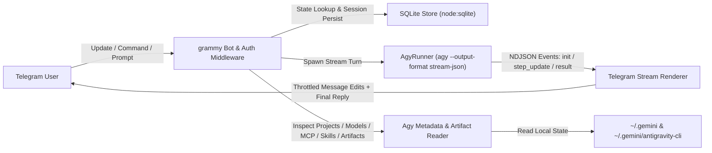

# Architecture Overview

`agy-telegram-bot` is a standalone TypeScript (Node.js >= 22, ESM) bridge between Telegram (`grammy`) and the Antigravity CLI (`agy` v1.5.18). It enables interactive multi-turn AI coding and workspace sessions from Telegram with live streaming output, project/conversation switching, artifact delivery, and zero native C++ dependencies via Node's built-in `node:sqlite`.

## High-Level Data Flow

## Planned Module Layout

| Module | Responsibility |
| :--- | :--- |
| `src/config.ts` | Loads `.env` via `dotenv`, expands `~` paths, validates required fields, and exports typed `AppConfig` via `loadConfig()`. |
| `src/agy/types.ts` | Exact TypeScript contracts for `agy` v1.5.18 stream-JSON events (`init`, `step_update`, `result`), CLI entities (`AgyProject`, `AgyConversation`, `AgyModel`, `AgyMcpServer`, `AgySkill`, `AgyArtifact`), and `AgyRunOptions`. |
| `src/agy/runner.ts` | Spawns `agy` child processes with `stream-json` output, parses NDJSON events line-by-line, enforces `MAX_TURN_TIMEOUT_MS`, and supports cancellation. |
| `src/agy/metadata.ts` | Queries `agy` CLI metadata and/or reads `~/.gemini` & `~/.gemini/antigravity-cli` for projects, conversations, models, MCP servers, skills, and generated artifacts. |
| `src/store/db.ts` | Persistent per-user / per-chat state (active project, active conversation ID, model, effort, permission mode, language) backed by `node:sqlite` (`DatabaseSync`) in `DATA_DIR`. |
| `src/bot/auth.ts` | Middleware restricting access to `ALLOWED_USER_IDS`. |
| `src/bot/streamer.ts` | Buffers `text_delta`, `thinking_delta`, and tool progress from `step_update` events; performs rate-limited Telegram message edits (`STREAM_EDIT_INTERVAL_MS`) and splits long responses into Telegram-safe chunks. |
| `src/bot/commands.ts` | Slash commands and inline keyboards (`/start`, `/help`, `/new`, `/projects`, `/conversations`, `/model`, `/effort`, `/mode`, `/mcp`, `/skills`, `/artifacts`, `/cancel`, `/status`). |
| `src/bot/i18n.ts` | Lightweight localization helpers driven by `BOT_LANG` (e.g., `en`, `fa`). |
| `src/index.ts` | Application entrypoint: loads config, initializes SQLite store, wires `grammy` handlers, and manages graceful shutdown (`SIGINT`/`SIGTERM`). |
| `scripts/setup.mjs` | Interactive bootstrap script for generating `.env` and verifying `agy` / Telegram bot connectivity. |

## Key Design Constraints

- **ESM & Strict TypeScript**: `"type": "module"`, `NodeNext` resolution, `strict: true`, targeting ES2022 on Node.js >= 22.
- **Zero Native Build Toolchain**: Uses Node 22's built-in `node:sqlite` instead of `better-sqlite3` or `sqlite3`.
- **Single Active Turn Guard**: Prevents concurrent `agy` mutations on the same conversation while allowing clean cancellation.
- **Testability**: `loadConfig({ allowMissingToken: true })` and dependency-injected runners allow `vitest` suites to run offline without a Telegram token or live `agy` daemon.
